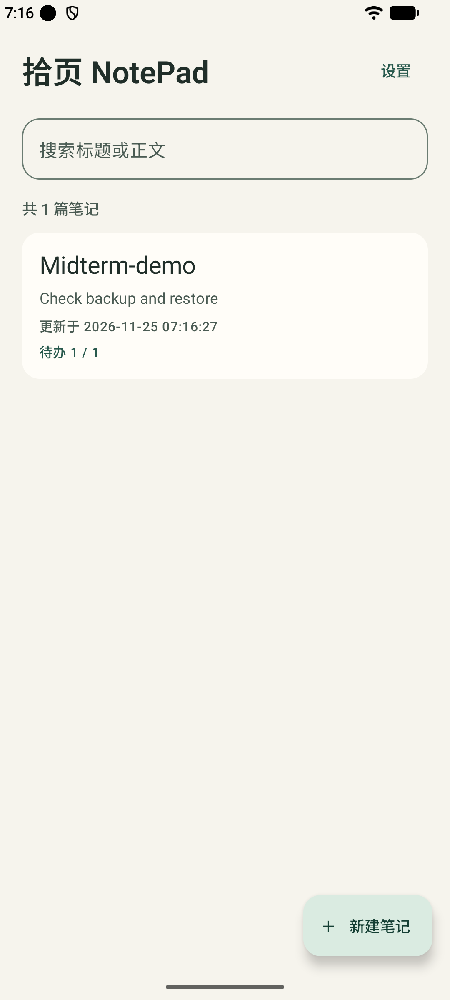
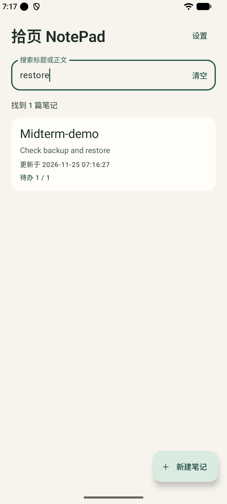
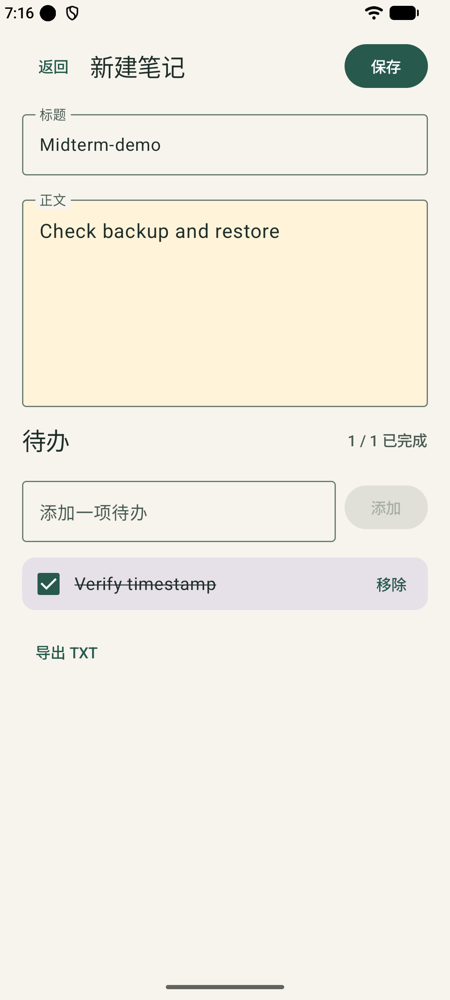
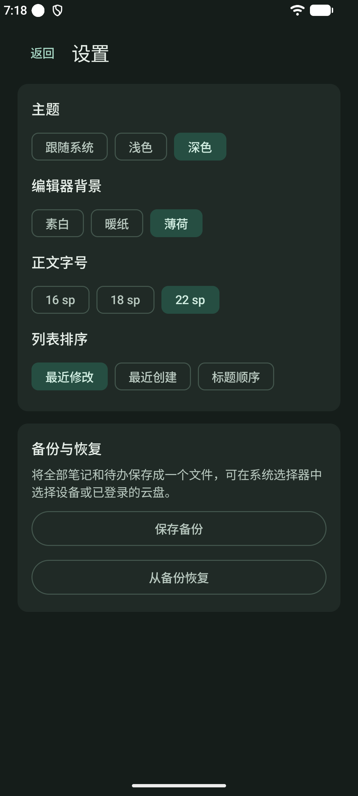
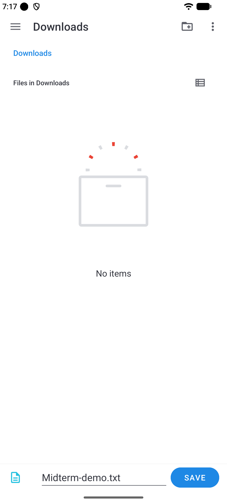
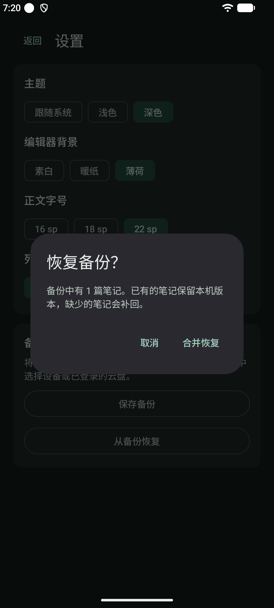

# 拾页 NotePad

移动应用开发课程期中项目。以课程提供的 [NotePad](https://github.com/fjnu-cse/NotePad) 为基础，用 Kotlin 和 Jetpack Compose 实现笔记列表、编辑器和设置页。

## 运行

在 Android Studio 打开 `Dev`，同步 Gradle 后选择 `midterm-notepad` 并运行。项目使用 Android SDK 37。在根目录也可以用 PowerShell 构建。仪器测试请在测试用模拟器运行，Gradle 的测试清理会卸载测试应用。

```powershell
.\gradlew.bat :midterm-notepad:assembleDebug
.\gradlew.bat :midterm-notepad:connectedDebugAndroidTest
```

## 功能与验收

| 功能 | 操作与预期结果 |
| --- | --- |
| 笔记时间戳 | 新建并保存笔记，列表卡片显示「更新于」及日期时间。修改并保存后，更新时间随之更新，创建时间保留在数据库中。 |
| 标题与正文搜索 | 新建一篇标题和正文各有独立关键词的笔记。分别输入两个关键词，两次都能找到这篇笔记。清空搜索框回到全部笔记。 |
| 界面主题 | 在设置中切换浅色或深色，整个应用随之变化。切换素白、暖纸或薄荷背景后，打开笔记可查看正文编辑区的效果。 |
| 笔记导出 | 打开笔记，点「导出 TXT」，在系统选择器中选位置。UTF-8 文本包含标题、正文和用 `[x]` 或 `[ ]` 标记的待办。 |
| 云端备份和恢复 | 在设置中点「保存备份」，选择已登录且出现在系统选择器中的云盘。点「从备份恢复」，选中备份文件后确认合并。缺少的笔记会补回，已有笔记保留本机版本。相同备份重复恢复时会跳过已有笔记。 |
| 待办 | 在编辑器中添加、勾选或移除待办，再保存笔记。列表卡片显示完成数，重新打开笔记可以看到保留的清单。 |
| 偏好设置 | 选择主题、编辑背景、正文字号或列表排序。退出重开后，应用沿用上次的选项。 |

## 实际运行截图

| 笔记列表与时间戳 | 正文关键词搜索 | 编辑器与待办 |
| --- | --- | --- |
|  |  |  |

| 主题和偏好设置 | TXT 导出 | 备份合并确认 |
| --- | --- | --- |
|  |  |  |

## 验证记录

在 Android 17 模拟器上，2 项仪器测试均通过。另通过应用界面完成了一次 TXT 导出，以及一次「备份 → 删除演示笔记 → 合并恢复」操作。恢复后核对了原时间戳与待办状态。重启应用后，深色主题、薄荷编辑背景和 22 sp 正文字号仍处于选中状态。本次备份往返使用模拟器的 Downloads，云盘端的实际传输可在设备登录对应云盘后验收。

## 技术实现

- 原版 `NotePad.java` 的表和 URI 约定作为契约。应用内的 `NotePadProvider` 用 SQLite 读写 `notes` 表。数据库从原表升级时保留标题、正文和时间，为旧笔记生成备份标识，并补上空待办。
- `NoteRepository` 将标题与正文的查询参数绑定到 SQLite `LIKE`，使 `%` 和 `_` 也能按字面搜索。保存时更新 `modified`，列表读取该时间戳。
- `NotesModel` 管理列表、编辑状态和异步读写。待办随笔记存储，页面通过同一份数据计算完成数。偏好使用 `SharedPreferences` 保存。
- `NoteArchive` 处理 UTF-8 文本和带版本的 JSON 备份。JSON 含笔记标识、标题、正文、创建时间、修改时间和待办。应用在写入数据库前验证整个备份，再用事务合并。Android Storage Access Framework 负责访问用户在系统选择器中选定的本机或云盘文件。[Android 文档](https://developer.android.com/training/data-storage/shared/documents-files)
- 云盘使用的账号、可用容量和同步状态由云盘应用管理。JSON 中包含笔记明文，请把备份保存在自己有权访问的位置。
